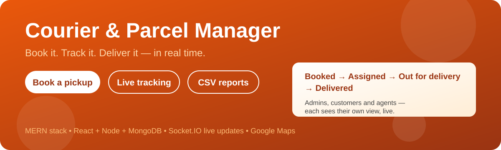
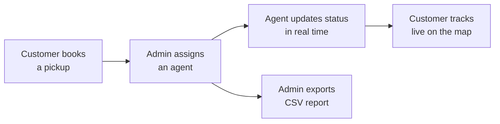

<p align="center">
  
</p>

<p align="center">
  <a href="https://github.com/smabdulmueid97/MERN-Stack-Courier-and-Parcel-Management-System"></a>
  <a href="https://github.com/smabdulmueid97/MERN-Stack-Courier-and-Parcel-Management-System"></a>
  <a href="https://github.com/smabdulmueid97/MERN-Stack-Courier-and-Parcel-Management-System"></a>
  <a href="https://github.com/smabdulmueid97/MERN-Stack-Courier-and-Parcel-Management-System"></a>
  <a href="https://github.com/smabdulmueid97/MERN-Stack-Courier-and-Parcel-Management-System/stargazers"></a>
</p>

<h1 align="center">MERN-Stack-Courier-and-Parcel-Management-System</h1>

<p align="center">
  A full-featured MERN logistics platform: customers <b>book parcel pickups</b>, admins <b>manage deliveries</b>, and agents <b>fulfil them in real time</b> — with role-based access, live tracking, geolocation, and CSV reports.
</p>

<p align="center">
  <a href="#-who-does-what">Roles</a> •
  <a href="#-who-does-what">Flow</a> •
  <a href="#-tech-stack">Stack</a> •
  <a href="#-environment-variables">Env vars</a> •
  <a href="#-install">Install</a> •
  <a href="#-layout">Layout</a>
</p>

---

## 👥 Who does what

| Role | Can do |
|---|---|
| **Admin** | Manage parcels, assign agents, monitor metrics (daily bookings, failed deliveries, COD totals), export CSV reports, manage all users |
| **Customer** | Register and log in, book parcels, track deliveries with real-time status updates, view booking history |
| **Delivery Agent** | See assigned parcels, update delivery status, view the delivery route on embedded Google Maps |

Login is **JWT-based** for all users, with middleware-controlled role-based access.



## 🧰 Tech stack

| Layer | Tech |
|---|---|
| Frontend | React.js, Tailwind CSS, Socket.IO, Google Maps API |
| Backend | Node.js, Express.js, MongoDB, JWT |
| Real-time | Socket.IO |

Geolocation uses the **Google Maps geocoding API** to resolve pickup and delivery addresses to coordinates. Each role gets its own view: admin sees the parcel overview, the agent sees the delivery plan, the customer sees order history.

## 🔑 Environment variables

Use placeholders — never commit real keys.

```bash
# client/.env
REACT_APP_Maps_API_KEY=YOUR_GOOGLE_MAPS_API_KEY
```

```bash
# server/.env
NODE_ENV=development
PORT=5001
MONGO_URI=your_mongo_connection_string
JWT_SECRET=YOUR_JWT_SECRET
Maps_API_KEY=YOUR_GOOGLE_MAPS_API_KEY
```

## 🚀 Install

```bash
git clone https://github.com/smabdulmueid97/MERN-Stack-Courier-and-Parcel-Management-System.git
cd MERN-Stack-Courier-and-Parcel-Management-System
```

Install dependencies — frontend first, then backend:

```bash
cd client
npm install

cd ../server
npm install
```

Start the app — run one in each terminal:

```bash
# Frontend (from client/)
npm start

# Backend (from server/)
npm start
```

The server runs on port **5001** (`PORT=5001` in `server/.env`).

## 🗂️ Layout

```
assets/banner.svg               # hero banner above
client/                         # React frontend — Tailwind, Socket.IO, Google Maps
server/                         # Node + Express backend — MongoDB, JWT, Socket.IO
ReadME.txt                      # original notes (install steps preserved here)
```

## License

No `LICENSE` file in this repo yet — add one to set the terms.
